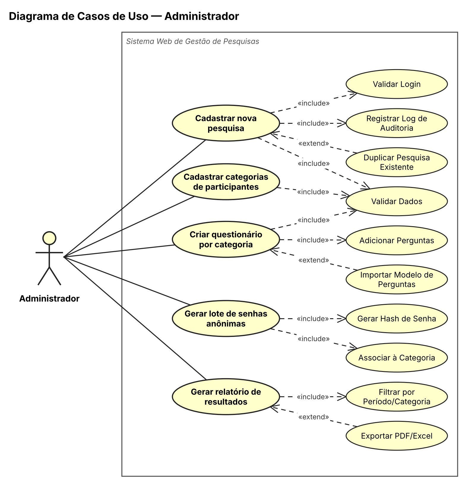
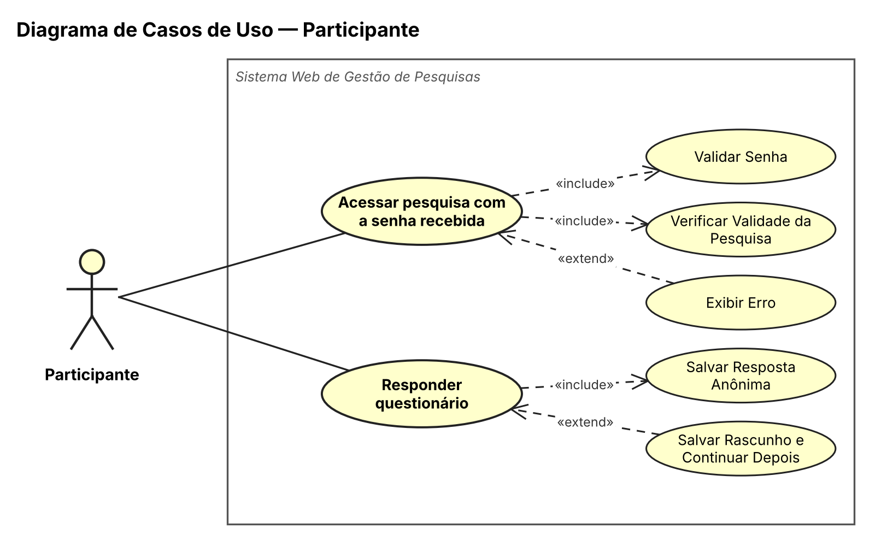
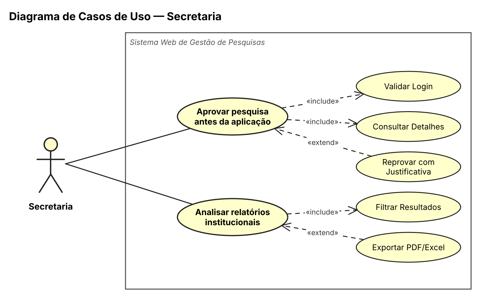
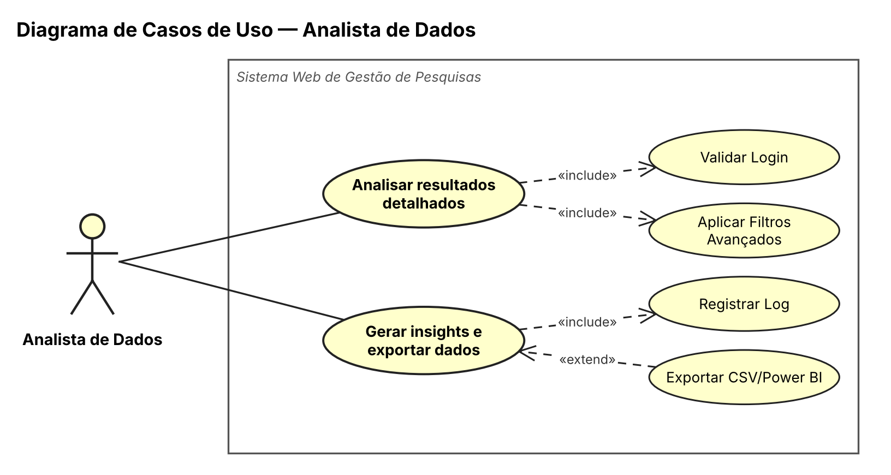
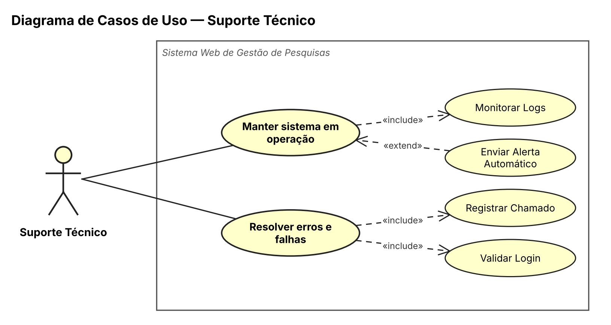
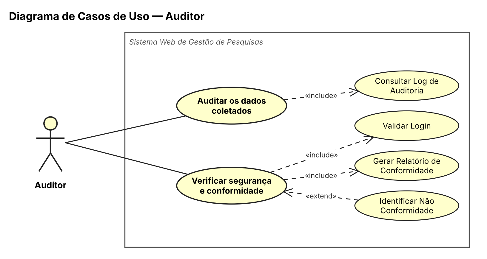

# Sistema Web para Gestão de Pesquisas por Questionários

## Requisitos e Casos de Uso

> Projeto Integrador I · ADS · Fatec Lins · 2026

---

## Sumário

1. [Atores](#1-atores)
2. [Requisitos Funcionais](#2-requisitos-funcionais)
3. [Requisitos Não Funcionais](#3-requisitos-não-funcionais)
   - [3.1 Usabilidade](#31-usabilidade)
   - [3.2 Desempenho](#32-desempenho)
   - [3.3 Portabilidade](#33-portabilidade)
   - [3.4 Anonimato e Privacidade (LGPD)](#34-anonimato-e-privacidade-lgpd)
   - [3.5 Disponibilidade](#35-disponibilidade)
   - [3.6 Integridade](#36-integridade)
   - [3.7 Confidencialidade](#37-confidencialidade)
   - [3.8 Autorização e Controle de Acesso](#38-autorização-e-controle-de-acesso)
4. [Casos de Uso](#4-casos-de-uso)
   - [4.1 Administrador](#41-administrador)
   - [4.2 Participante](#42-participante)
   - [4.3 Secretaria](#43-secretaria)
   - [4.4 Analista de Dados](#44-analista-de-dados)
   - [4.5 Suporte Técnico](#45-suporte-técnico)
   - [4.6 Auditor](#46-auditor)
5. [Matriz de Rastreabilidade](#5-matriz-de-rastreabilidade)

---

## 1. Atores

| Ator | Descrição | Acesso |
|---|---|---|
| **Administrador** | Cria e gerencia pesquisas, categorias, questionários, senhas e relatórios. | Total (login) |
| **Participante** | Recebe uma senha anônima e responde ao questionário da sua categoria. Não possui conta. | Apenas por senha anônima |
| **Secretaria** | Aprova pesquisas antes da aplicação e analisa relatórios institucionais. | Login — aprovação e relatórios |
| **Analista de Dados** | Analisa resultados, gera insights e exporta dados para uso externo. | Login — somente leitura |
| **Suporte Técnico** | Mantém o sistema em operação e resolve erros e falhas. | Login — monitoramento e chamados |
| **Auditor** | Audita os dados coletados e verifica segurança e conformidade com a LGPD. | Login — somente leitura |

---

## 2. Requisitos Funcionais

> Descrevem **o que** o sistema deve fazer. RF01–RF12 vêm do enunciado do projeto; RF13–RF19 foram derivados dos casos de uso dos atores Secretaria, Suporte Técnico, Auditor e Participante.

| ID | Requisito | Ator(es) | Caso(s) de uso |
|---|---|---|---|
| RF01 | Cadastrar pesquisas (título, descrição, período e status) | Administrador | UC-ADM-01 |
| RF02 | Cadastrar categorias de participantes (ex.: Alunos, Professores, Colaboradores) | Administrador | UC-ADM-02 |
| RF03 | Criar questionários por categoria | Administrador | UC-ADM-03 |
| RF04 | Cadastrar perguntas e alternativas de resposta (múltipla escolha única/múltipla, escala, aberta) | Administrador | UC-ADM-03 |
| RF05 | Gerar senhas anônimas por lote e por categoria | Administrador | UC-ADM-04 |
| RF06 | Exportar senhas geradas (PDF ou CSV) | Administrador | UC-ADM-04 |
| RF07 | Aplicar questionários via senha anônima | Participante | UC-PAR-01 |
| RF08 | Registrar respostas no banco de dados | Participante | UC-PAR-02 |
| RF09 | Impedir reutilização de senhas (marcar senha como utilizada) | Participante | UC-PAR-01, UC-PAR-02 |
| RF10 | Monitorar participação em tempo real (dashboard: senhas geradas, respostas recebidas, taxa de participação, participação por categoria) | Administrador | UC-ADM-05 |
| RF11 | Gerar relatórios estatísticos por pergunta, por categoria e comparativos, com gráficos | Administrador, Secretaria, Analista | UC-ADM-05, UC-SEC-02, UC-ANA-01 |
| RF12 | Exportar resultados (PDF, CSV, XLSX) | Administrador, Secretaria, Analista | UC-ADM-05, UC-SEC-02, UC-ANA-02 |
| RF13 | Aprovar ou reprovar pesquisas antes da aplicação, com justificativa na reprovação | Secretaria | UC-SEC-01 |
| RF14 | Autenticar usuários internos e liberar funções conforme o perfil | Todos exceto Participante | UC-ADM-01, UC-SEC-01, UC-ANA-01, UC-SUP-02, UC-AUD-02 |
| RF15 | Registrar trilha de auditoria (quem, o quê, quando) | Sistema | UC-ADM-01, UC-ANA-02, UC-AUD-01 |
| RF16 | Monitorar serviços (APIs, banco, servidores) e enviar alertas automáticos | Suporte Técnico | UC-SUP-01 |
| RF17 | Registrar e acompanhar chamados técnicos com severidade e SLA | Suporte Técnico | UC-SUP-02 |
| RF18 | Gerar relatório de conformidade de segurança e LGPD | Auditor | UC-AUD-02 |
| RF19 | Salvar rascunho das respostas e permitir continuar depois | Participante | UC-PAR-02 |

---

## 3. Requisitos Não Funcionais

> Definem **como** o sistema deve se comportar: qualidades, restrições e segurança.

### 3.1 Usabilidade

| ID | Requisito |
|---|---|
| RNF01 | Interface web amigável e layout responsivo, acessível em desktop e dispositivos móveis. |
| RNF02 | Interface do participante *mobile-first*, permitindo concluir o questionário em menos de 5 minutos em média. |
| RNF03 | Perguntas obrigatórias devem ser marcadas visualmente; em caso de pendência, a tela rola até a pergunta e a destaca. |
| RNF04 | Mensagens de erro claras, mantendo os campos já preenchidos para correção. |

### 3.2 Desempenho

| ID | Requisito |
|---|---|
| RNF05 | Suportar múltiplos acessos simultâneos sem degradação de desempenho. |
| RNF06 | Acesso ao questionário pela senha em menos de 2 segundos. |
| RNF07 | Gráficos de análise avançada gerados em até 3 segundos. |
| RNF08 | Relatórios exibidos e exportados em menos de 5 segundos para até 10 mil respostas. |

### 3.3 Portabilidade

| ID | Requisito |
|---|---|
| RNF09 | Funcionamento nos navegadores modernos: Chrome, Firefox, Edge e Safari. |

### 3.4 Anonimato e Privacidade (LGPD)

| ID | Requisito |
|---|---|
| RNF10 | Nenhuma resposta pode ser rastreada até o respondente individual. |
| RNF11 | Senhas de acesso sem vínculo com CPF, e-mail, nome ou qualquer dado pessoal. |
| RNF12 | As respostas são gravadas sem IP, cookies ou identificadores. |
| RNF13 | Relatórios exibem apenas dados agregados (percentuais e totais), nunca respostas individuais. |
| RNF14 | Exportações para uso externo passam por anonimização obrigatória. |
| RNF15 | Logs de auditoria totalmente dissociados das respostas dos questionários. |

### 3.5 Disponibilidade

| ID | Requisito |
|---|---|
| RNF16 | Disponibilidade (uptime) mínima de 99%. |
| RNF17 | Monitoramento de serviços, banco de dados e APIs, com dashboard atualizado a cada 30 segundos. |
| RNF18 | Alerta automático em menos de 5 minutos após uma falha. |
| RNF19 | Backup periódico dos dados e restauração segura em caso de falha ou incidente. |
| RNF20 | Plano de recuperação de desastres (*Disaster Recovery*) e mecanismos de redundância. |
| RNF21 | Proteção contra ataques de negação de serviço (DoS/DDoS) e limite de requisições excessivas (*rate limiting*). |
| RNF22 | SLA de chamados: até 4 h para severidade crítica e até 24 h para severidade média. |

### 3.6 Integridade

| ID | Requisito |
|---|---|
| RNF23 | Dados trafegados protegidos por HTTPS/TLS. |
| RNF24 | Restrições de integridade no banco (PK, FK, *constraints*, integridade referencial) para evitar duplicidades, registros órfãos, exclusões indevidas e inconsistências. |
| RNF25 | Transações no banco de dados em operações críticas. |
| RNF26 | Validação de campos obrigatórios antes da gravação, incluindo as perguntas obrigatórias dos questionários. |
| RNF27 | Validação de entrada contra SQL Injection e Cross-Site Scripting (XSS). |
| RNF28 | Upload de usuários comuns restrito a PNG e JPG, com validação de extensão, tamanho e antivírus. |
| RNF29 | Logs imutáveis (WORM), protegidos contra alteração ou exclusão, com retenção mínima de 5 anos. |
| RNF30 | Histórico de alterações relevantes mantido para rastreabilidade, conforme a política de segurança. |
| RNF31 | Quando houver cadastro com CPF: validar 11 dígitos numéricos e o algoritmo oficial da Receita Federal, impedir menores de 18 anos e pessoas falecidas (quando aplicável). |

### 3.7 Confidencialidade

| ID | Requisito |
|---|---|
| RNF32 | Senhas nunca armazenadas em texto puro: armazenar apenas o hash. A senha em texto existe somente no momento da exportação do lote. |
| RNF33 | Algoritmos seguros de criptografia e hash: SHA-256 para senhas anônimas (conforme casos de uso); sugestão de BCrypt/Argon2 para senhas de usuários e AES-256 para dados sensíveis. |
| RNF34 | Informações sensíveis não exibidas integralmente em logs, relatórios ou telas. |
| RNF35 | Acesso a informações sensíveis restrito a usuários autorizados, conforme o privilégio mínimo. |

### 3.8 Autorização e Controle de Acesso

| ID | Requisito |
|---|---|
| RNF36 | Cada usuário visualiza somente as funcionalidades e informações do seu perfil. |
| RNF37 | Princípio do menor privilégio, com separação entre usuários comuns, analistas e administradores. |
| RNF38 | Funções administrativas, APIs, banco, arquivos e painéis protegidos contra acesso não autorizado. |
| RNF39 | Validação de permissões no frontend **e** no backend. |
| RNF40 | Controle de acesso específico para visualizar, editar, excluir e exportar dados. |
| RNF41 | Bloqueio de múltiplos acessos simultâneos indevidos com a mesma conta. |
| RNF42 | Revogação automática de permissões de usuários inativos ou desabilitados. |
| RNF43 | Bloqueio temporário após 3 tentativas de senha inválida em 15 minutos. |
| RNF44 | Participantes acessam apenas o questionário da categoria vinculada à sua senha. |

---

## 4. Casos de Uso

**Convenções**

- **«include»**: comportamento sempre executado pelo caso de uso base.
- **«extend»**: comportamento opcional ou condicional que estende o caso de uso base.
- **FA**: fluxo alternativo. O passo indicado refere-se ao fluxo principal.

---

### 4.1 Administrador

#### UC-ADM-01 — Cadastrar Nova Pesquisa

| Campo | Descrição |
|---|---|
| **User story** | Como Administrador, quero cadastrar uma nova pesquisa informando título, descrição e período, para iniciar o ciclo de uma pesquisa. |
| **Ator** | Administrador |
| **Pré-condição** | Administrador autenticado. |
| **Pós-condição** | Pesquisa gravada com status **"Rascunho"** e operação registrada no log. |
| **«include»** | Validar Login · Validar Dados Obrigatórios · Registrar Log de Auditoria |
| **«extend»** | Duplicar Pesquisa Existente |
| **Requisitos** | RF01, RF14, RF15 |

**Fluxo principal**

1. O Administrador acessa a área de gestão e se autentica.
2. Clica em **"Nova Pesquisa"**.
3. Informa título, descrição e período de aplicação (data/hora de início e fim).
4. Clica em **"Salvar"**.
5. O sistema valida as regras e os campos obrigatórios.
6. O sistema grava a pesquisa com status "Rascunho".
7. O sistema registra a operação na trilha de auditoria.
8. O sistema exibe mensagem de sucesso.

**Fluxos alternativos**

| FA | Passo | Condição | Comportamento / mensagem |
|---|---|---|---|
| FA1 | 5 | Título vazio | "Título é obrigatório." |
| FA2 | 5 | Data fim anterior ao início ou data retroativa | Salvamento interrompido, campos mantidos: "Data fim deve ser posterior à data início." |
| FA3 | qualquer | Sessão expirada | "Sua sessão expirou. Faça login novamente." |

**Critérios de aceitação**

- [ ] Título obrigatório, com 5 a 100 caracteres.
- [ ] Período futuro e data fim > data início.
- [ ] Pesquisa criada inicia com status "Rascunho".
- [ ] Log registra usuário, data/hora e ação.

---

#### UC-ADM-02 — Cadastrar Categorias de Participantes

| Campo | Descrição |
|---|---|
| **User story** | Como Administrador, quero cadastrar categorias (ex.: Alunos, Professores), para segmentar o público-alvo. |
| **Ator** | Administrador |
| **Pré-condição** | Pesquisa em edição. |
| **Pós-condição** | Categoria gravada e vinculada à pesquisa. |
| **«include»** | Validar Dados |
| **Requisitos** | RF02 |

**Fluxo principal**

1. O Administrador acessa o módulo de categorias.
2. Digita o nome da nova categoria.
3. Clica em **"Adicionar Categoria"**.
4. O sistema valida se o nome está preenchido e é único.
5. O sistema grava a categoria e a vincula à pesquisa em edição.

**Fluxos alternativos**

| FA | Passo | Condição | Comportamento / mensagem |
|---|---|---|---|
| FA1 | 4 | Nome já existente (*case-insensitive*) | Inserção bloqueada: "Categoria já existe." |
| FA2 | 4 | Nome vazio | "Informe um nome válido." |

**Critérios de aceitação**

- [ ] Nome único (*case-insensitive*), máximo de 50 caracteres.
- [ ] Não permite excluir categoria em uso.

---

#### UC-ADM-03 — Criar Questionário por Categoria

| Campo | Descrição |
|---|---|
| **User story** | Como Administrador, quero criar um questionário vinculado a uma categoria, para adequar as perguntas ao perfil do público. |
| **Ator** | Administrador |
| **Pré-condição** | Categoria previamente cadastrada. |
| **Pós-condição** | Questionário associado exclusivamente à categoria. |
| **«include»** | Validar Dados · Adicionar Perguntas |
| **«extend»** | Importar Modelo de Perguntas |
| **Requisitos** | RF03, RF04 |

**Fluxo principal**

1. O Administrador seleciona uma categoria cadastrada.
2. Insere as perguntas e define os tipos.
3. Configura as alternativas e marca as questões obrigatórias.
4. Clica em **"Salvar Questionário"**.
5. O sistema valida o questionário.
6. O sistema associa o questionário exclusivamente à categoria.

**Fluxos alternativos**

| FA | Passo | Condição | Comportamento / mensagem |
|---|---|---|---|
| FA1 | 5 | Nenhuma pergunta incluída | Nada é gravado: "Adicione pelo menos 1 pergunta." |

**Critérios de aceitação**

- [ ] Mínimo de 1 e máximo de 50 perguntas.
- [ ] Tipos permitidos: múltipla escolha, escala Likert e aberta.
- [ ] Perguntas obrigatórias marcadas visualmente.

---

#### UC-ADM-04 — Gerar Lote de Senhas Anônimas

| Campo | Descrição |
|---|---|
| **User story** | Como Administrador, quero gerar um lote de senhas anônimas, para distribuir acessos seguros sem identificar os participantes. |
| **Ator** | Administrador |
| **Pré-condição** | Pesquisa aprovada pela Secretaria e categoria cadastrada. |
| **Pós-condição** | Hashes gravados e lote disponível para download imediato. |
| **«include»** | Gerar Hash de Senha · Associar à Categoria |
| **Requisitos** | RF05, RF06 |

**Fluxo principal**

1. O Administrador informa a quantidade de senhas e a categoria.
2. Clica em **"Gerar Lote"**.
3. O sistema gera senhas aleatórias e únicas de 8 caracteres alfanuméricos, associadas à categoria.
4. O sistema calcula o hash SHA-256 de cada senha.
5. O sistema grava os hashes sem nenhuma associação a dados pessoais.
6. O sistema disponibiliza o lote em texto puro apenas para download imediato.

**Fluxos alternativos**

| FA | Passo | Condição | Comportamento / mensagem |
|---|---|---|---|
| FA1 | 2 | Quantidade zero ou inválida | "Informe quantidade maior que zero." |
| FA2 | 3 | Falha na geração | "Erro ao gerar senhas. Tente novamente." |

**Critérios de aceitação**

- [ ] Senhas únicas com 8 caracteres alfanuméricos.
- [ ] Apenas o hash SHA-256 é armazenado; texto puro só na exportação.
- [ ] Nenhum vínculo com CPF, e-mail ou nome (LGPD).
- [ ] Lote exportável em CSV (e PDF, conforme RF06).

---

#### UC-ADM-05 — Gerar Relatório de Resultados

| Campo | Descrição |
|---|---|
| **User story** | Como Administrador, quero gerar o relatório de resultados, para acompanhar o desempenho da pesquisa. |
| **Ator** | Administrador |
| **Pré-condição** | Pesquisa com respostas registradas. |
| **Pós-condição** | Resultados agregados exibidos em gráficos. |
| **«include»** | Filtrar por Período/Categoria |
| **«extend»** | Exportar PDF/Excel |
| **Requisitos** | RF10, RF11, RF12 |

**Fluxo principal**

1. O Administrador acessa a aba de relatórios e aplica os filtros obrigatórios (pesquisa e período).
2. Solicita a consolidação dos dados.
3. O sistema executa uma consulta agregada (percentuais e contadores).
4. O sistema exibe os resultados em gráficos em menos de 5 segundos.

**Fluxos alternativos**

| FA | Passo | Condição | Comportamento / mensagem |
|---|---|---|---|
| FA1 | 3 | Nenhuma resposta no período | Gráficos suprimidos: "Nenhuma resposta encontrada para os filtros." |

**Critérios de aceitação**

- [ ] Exibe apenas dados agregados (% e totais), nunca respostas individuais.
- [ ] Filtros obrigatórios: pesquisa + período.
- [ ] Exportação em menos de 5 s para até 10 mil respostas.

---

### 4.2 Participante

#### UC-PAR-01 — Acessar Pesquisa com Senha

| Campo | Descrição |
|---|---|
| **User story** | Como Participante, quero acessar com a senha recebida, para responder mantendo o anonimato. |
| **Ator** | Participante |
| **Pré-condição** | Possuir uma senha válida e não utilizada. |
| **Pós-condição** | Questionário da categoria exibido. |
| **«include»** | Validar Senha · Verificar Validade da Pesquisa |
| **«extend»** | Exibir Erro |
| **Requisitos** | RF07, RF09 |

**Fluxo principal**

1. O Participante acessa a URL pública do sistema.
2. Digita a senha recebida e clica em **"Acessar"**.
3. O sistema busca o hash SHA-256 da senha no banco.
4. O sistema verifica se a pesquisa está no período de vigência.
5. O sistema identifica a categoria vinculada e exibe o questionário em menos de 2 segundos.

**Fluxos alternativos**

| FA | Passo | Condição | Comportamento / mensagem |
|---|---|---|---|
| FA1 | 3 | Senha não encontrada | "Senha não encontrada. Tentativa 1 de 3." |
| FA2 | 3 | 3 tentativas inválidas | "Acesso bloqueado temporariamente." |
| FA3 | 3 | Senha com status "Utilizada" | Questionário bloqueado: "Esta senha já foi utilizada." |
| FA4 | 4 | Pesquisa fora do período | "Esta pesquisa não está mais disponível." |

**Critérios de aceitação**

- [ ] Máximo de 3 tentativas em 15 minutos.
- [ ] Não armazena IP, cookie ou identificação.
- [ ] Senha válida apenas no período da pesquisa.
- [ ] Acesso em menos de 2 segundos.

---

#### UC-PAR-02 — Responder Questionário

| Campo | Descrição |
|---|---|
| **User story** | Como Participante, quero responder de forma simples e rápida, para concluir em menos de 5 minutos. |
| **Ator** | Participante |
| **Pré-condição** | Acesso validado (UC-PAR-01). |
| **Pós-condição** | Respostas gravadas anonimamente e senha marcada como "Utilizada". |
| **«include»** | Salvar Resposta Anônima |
| **«extend»** | Salvar Rascunho e Continuar Depois |
| **Requisitos** | RF08, RF09, RF19 |

**Fluxo principal**

1. O Participante responde às perguntas em interface responsiva.
2. O sistema salva o progresso automaticamente a cada pergunta.
3. O Participante preenche as obrigatórias e clica em **"Concluir/Enviar"**.
4. O sistema verifica a integridade das respostas.
5. O sistema grava as respostas de forma anônima, sem IP, cookies ou IDs.
6. O sistema marca a senha como "Utilizada".
7. O sistema exibe a confirmação de envio.

**Fluxos alternativos**

| FA | Passo | Condição | Comportamento / mensagem |
|---|---|---|---|
| FA1 | 4 | Pergunta obrigatória sem resposta | Nada é gravado; a tela rola até a pergunta e a destaca: "Responda todas as perguntas obrigatórias." |
| FA2 | 5 | Falha de conexão | "Não foi possível enviar. Respostas salvas localmente." |

**Critérios de aceitação**

- [ ] Interface *mobile-first*.
- [ ] Progresso salvo automaticamente a cada pergunta.
- [ ] Confirmação final não armazena identificador.
- [ ] Tempo médio de resposta inferior a 5 minutos.

---

### 4.3 Secretaria

#### UC-SEC-01 — Aprovar Pesquisa antes da Aplicação

| Campo | Descrição |
|---|---|
| **User story** | Como Secretaria, quero aprovar pesquisas antes da liberação, para garantir a conformidade institucional. |
| **Ator** | Secretaria |
| **Pré-condição** | Pesquisa com status **"Em análise"**. |
| **Pós-condição** | Status alterado para **"Aprovada"** (ou mantido em análise com reprovação justificada) e Administrador notificado. |
| **«include»** | Validar Login · Consultar Detalhes |
| **«extend»** | Reprovar com Justificativa |
| **Requisitos** | RF13, RF14 |

**Fluxo principal**

1. A Secretaria faz login no painel institucional.
2. Seleciona uma pesquisa com status "Em análise".
3. Revisa descrição, categorias e perguntas.
4. Clica em **"Aprovar Pesquisa"**.
5. O sistema altera o status para "Aprovada", liberando a geração de senhas.
6. O sistema notifica o Administrador.

**Fluxos alternativos**

| FA | Passo | Condição | Comportamento / mensagem |
|---|---|---|---|
| FA1 | 1 | Usuário sem permissão | "Você não tem permissão para aprovar." |
| FA2 | 4 | Reprovação sem justificativa (ou com menos de 10 caracteres) | Status mantido em análise: "Informe o motivo da reprovação." |

**Critérios de aceitação**

- [ ] Apenas pesquisas "Em análise" aparecem na lista.
- [ ] Aprovação muda o status para "Aprovada" e libera as senhas.
- [ ] Reprovação exige justificativa de no mínimo 10 caracteres.
- [ ] Notificação automática ao Administrador.

---

#### UC-SEC-02 — Analisar Relatórios Institucionais

| Campo | Descrição |
|---|---|
| **User story** | Como Secretaria, quero analisar relatórios consolidados, para apoiar decisões estratégicas. |
| **Ator** | Secretaria |
| **Pré-condição** | Usuário autenticado; pesquisas com respostas. |
| **Pós-condição** | Dados agregados exibidos e, opcionalmente, exportados. |
| **«include»** | Filtrar Resultados (reusa o filtro do Administrador) |
| **«extend»** | Exportar PDF/Excel |
| **Requisitos** | RF11, RF12 |

**Fluxo principal**

1. A Secretaria acessa o painel institucional.
2. Aplica filtros por unidade/campus e período.
3. O sistema exibe dados consolidados e gráficos, sem dados individuais.
4. A Secretaria clica em **"Exportar Relatório"**.
5. O sistema gera o documento com a identidade visual da instituição.

**Fluxos alternativos**

| FA | Passo | Condição | Comportamento / mensagem |
|---|---|---|---|
| FA1 | 3 | Nenhuma resposta para o filtro | Exportação cancelada: "Nenhum dado para o período selecionado." |

**Critérios de aceitação**

- [ ] Visão por unidade/campus.
- [ ] Dados agregados, sem identificação.
- [ ] Exportação com brasão institucional.

---

### 4.4 Analista de Dados

#### UC-ANA-01 — Analisar Resultados Detalhados

| Campo | Descrição |
|---|---|
| **User story** | Como Analista de Dados, quero analisar resultados com filtros avançados, para identificar tendências. |
| **Ator** | Analista de Dados |
| **Pré-condição** | Usuário com perfil de análise autenticado. |
| **Pós-condição** | Gráficos de correlação exibidos. |
| **«include»** | Validar Login · Aplicar Filtros Avançados |
| **Requisitos** | RF11, RF14 |

**Fluxo principal**

1. O Analista faz login com perfil técnico.
2. Acessa a central de análise da pesquisa.
3. Define filtros combinando categoria, período e cruzamento de perguntas.
4. O sistema processa as consultas e exibe os gráficos em até 3 segundos.

**Fluxos alternativos**

| FA | Passo | Condição | Comportamento / mensagem |
|---|---|---|---|
| FA1 | 1 | Perfil sem permissão | "Perfil sem permissão de análise." |
| FA2 | 3 | Nenhum filtro selecionado | Processamento recusado: "Selecione pelo menos um critério." |

**Critérios de aceitação**

- [ ] Acesso somente leitura.
- [ ] Filtros: categoria, período e pergunta.
- [ ] Gráficos gerados em menos de 3 segundos.

---

#### UC-ANA-02 — Gerar Insights e Exportar Dados

| Campo | Descrição |
|---|---|
| **User story** | Como Analista de Dados, quero gerar insights e exportar dados, para apresentações gerenciais. |
| **Ator** | Analista de Dados |
| **Pré-condição** | Pesquisa com respostas registradas. |
| **Pós-condição** | Arquivo anonimizado gerado e exportação registrada no log. |
| **«include»** | Registrar Log |
| **«extend»** | Exportar CSV/Power BI |
| **Requisitos** | RF12, RF15 |

**Fluxo principal**

1. O Analista solicita a extração dos resultados agregados (ex.: para Power BI).
2. O sistema aplica a anonimização obrigatória.
3. O sistema gera os arquivos em CSV ou XLSX.
4. O sistema registra no log quem exportou, a data e a hora.

**Fluxos alternativos**

| FA | Passo | Condição | Comportamento / mensagem |
|---|---|---|---|
| FA1 | 1 | Pesquisa sem respostas | Download retido: "Não há dados para exportar." |

**Critérios de aceitação**

- [ ] Exportação anonimizada obrigatória.
- [ ] Log registra quem exportou e quando.
- [ ] Formatos: CSV e XLSX.

---

### 4.5 Suporte Técnico

#### UC-SUP-01 — Manter Sistema em Operação

| Campo | Descrição |
|---|---|
| **User story** | Como Suporte Técnico, quero monitorar o sistema continuamente, para garantir disponibilidade de 99%. |
| **Ator** | Suporte Técnico |
| **Pré-condição** | Ferramenta de monitoramento ativa. |
| **Pós-condição** | Sistema operando ou equipe de plantão alertada. |
| **«include»** | Monitorar Logs |
| **«extend»** | Enviar Alerta Automático |
| **Requisitos** | RF16 |

**Fluxo principal**

1. O Suporte inicia a ferramenta de monitoramento.
2. O sistema exibe o status de APIs, banco de dados e servidores, atualizado a cada 30 segundos.
3. O sistema opera estável, com uptime mínimo de 99%.

**Fluxos alternativos**

| FA | Passo | Condição | Comportamento / mensagem |
|---|---|---|---|
| FA1 | 2 | Queda de serviço | Erro detectado em menos de 5 min; alerta com o log do erro enviado ao plantão. |
| FA2 | 1 | Serviço de logs fora do ar | "Serviço de logs indisponível." |
| FA3 | FA1 | Falha no envio do alerta | "Erro no envio de e-mail." |

**Critérios de aceitação**

- [ ] Uptime mínimo de 99%.
- [ ] Alerta em menos de 5 minutos após a falha.
- [ ] Dashboard atualizado a cada 30 segundos.

---

#### UC-SUP-02 — Resolver Erros e Falhas

| Campo | Descrição |
|---|---|
| **User story** | Como Suporte Técnico, quero resolver os erros reportados, para restaurar a operação rapidamente. |
| **Ator** | Suporte Técnico |
| **Pré-condição** | Falha relatada ou detectada. |
| **Pós-condição** | Chamado fechado dentro do SLA, com histórico documentado. |
| **«include»** | Registrar Chamado · Validar Login |
| **Requisitos** | RF14, RF17 |

**Fluxo principal**

1. O Suporte faz login na plataforma de chamados.
2. Analisa a falha e abre um chamado.
3. O sistema gera um número de ticket único com a severidade.
4. O Suporte aplica a correção e documenta as ações.
5. O chamado é fechado dentro do SLA.

**Fluxos alternativos**

| FA | Passo | Condição | Comportamento / mensagem |
|---|---|---|---|
| FA1 | 2 | Já existe chamado aberto para o mesmo erro/componente | Duplicação bloqueada: "Já existe chamado aberto para este erro." |

**Critérios de aceitação**

- [ ] Todo atendimento gera ticket.
- [ ] SLA: crítico em até 4 h, médio em até 24 h.
- [ ] Histórico completo de ações.

---

### 4.6 Auditor

#### UC-AUD-01 — Auditar os Dados Coletados

| Campo | Descrição |
|---|---|
| **User story** | Como Auditor, quero auditar os dados coletados, para garantir integridade e rastreabilidade. |
| **Ator** | Auditor |
| **Pré-condição** | Usuário com perfil de auditoria autenticado. |
| **Pós-condição** | Integridade e rastreabilidade validadas. |
| **«include»** | Consultar Log de Auditoria |
| **Requisitos** | RF15 |

**Fluxo principal**

1. O Auditor acessa o módulo de conformidade.
2. Solicita a listagem cronológica do log de auditoria.
3. O sistema exibe os registros imutáveis: quem fez alterações críticas e quando.
4. O Auditor valida a integridade da base e a rastreabilidade dos processos.

**Fluxos alternativos**

| FA | Passo | Condição | Comportamento / mensagem |
|---|---|---|---|
| FA1 | 2 | Logs rotacionados ou em backup | "Serviço de logs temporariamente indisponível para consulta." |
| FA2 | 3 | Log corrompido | "Integridade do log comprometida." |

**Critérios de aceitação**

- [ ] Acesso somente leitura.
- [ ] Trilha completa: quem, o quê e quando.
- [ ] Logs imutáveis (WORM).
- [ ] Retenção mínima de 5 anos.

---

#### UC-AUD-02 — Verificar Segurança e Conformidade (LGPD)

| Campo | Descrição |
|---|---|
| **User story** | Como Auditor, quero verificar a conformidade com a LGPD, para evitar riscos legais. |
| **Ator** | Auditor |
| **Pré-condição** | Usuário com perfil de auditoria autenticado. |
| **Pós-condição** | Relatório de conformidade emitido (com ou sem não conformidades). |
| **«include»** | Validar Login · Gerar Relatório de Conformidade |
| **«extend»** | Identificar Não Conformidade |
| **Requisitos** | RF14, RF18 |

**Fluxo principal**

1. O Auditor se autentica no painel de segurança.
2. Executa a verificação de integridade dos hashes e dos dados criptografados.
3. O sistema confirma que nenhuma resposta individual pode ser reidentificada.
4. O sistema emite relatório atestando a conformidade.

**Fluxos alternativos**

| FA | Passo | Condição | Comportamento / mensagem |
|---|---|---|---|
| FA1 | 2 | Parâmetro de segurança não atendido | Selo de aprovação suspenso; anomalias em vermelho e alerta no painel: "Dados pessoais identificados sem anonimização – Ação requerida." |
| FA2 | 4 | Nenhuma violação | "Nenhuma violação encontrada." |

**Critérios de aceitação**

- [ ] Relatório lista todas as coletas e bases legais.
- [ ] Verifica ausência de dados pessoais nas respostas.
- [ ] Gera evidências para auditoria externa.

---

## 5. Matriz de Rastreabilidade

| RF | ADM-01 | ADM-02 | ADM-03 | ADM-04 | ADM-05 | PAR-01 | PAR-02 | SEC-01 | SEC-02 | ANA-01 | ANA-02 | SUP-01 | SUP-02 | AUD-01 | AUD-02 |
|---|:-:|:-:|:-:|:-:|:-:|:-:|:-:|:-:|:-:|:-:|:-:|:-:|:-:|:-:|:-:|
| RF01 | ✔ | | | | | | | | | | | | | | |
| RF02 | | ✔ | | | | | | | | | | | | | |
| RF03 | | | ✔ | | | | | | | | | | | | |
| RF04 | | | ✔ | | | | | | | | | | | | |
| RF05 | | | | ✔ | | | | | | | | | | | |
| RF06 | | | | ✔ | | | | | | | | | | | |
| RF07 | | | | | | ✔ | | | | | | | | | |
| RF08 | | | | | | | ✔ | | | | | | | | |
| RF09 | | | | | | ✔ | ✔ | | | | | | | | |
| RF10 | | | | | ✔ | | | | | | | | | | |
| RF11 | | | | | ✔ | | | | ✔ | ✔ | | | | | |
| RF12 | | | | | ✔ | | | | ✔ | | ✔ | | | | |
| RF13 | | | | | | | | ✔ | | | | | | | |
| RF14 | ✔ | | | | | | | ✔ | | ✔ | | | ✔ | | ✔ |
| RF15 | ✔ | | | | | | | | | | ✔ | | | ✔ | |
| RF16 | | | | | | | | | | | | ✔ | | | |
| RF17 | | | | | | | | | | | | | ✔ | | |
| RF18 | | | | | | | | | | | | | | | ✔ |
| RF19 | | | | | | | ✔ | | | | | | | | |
